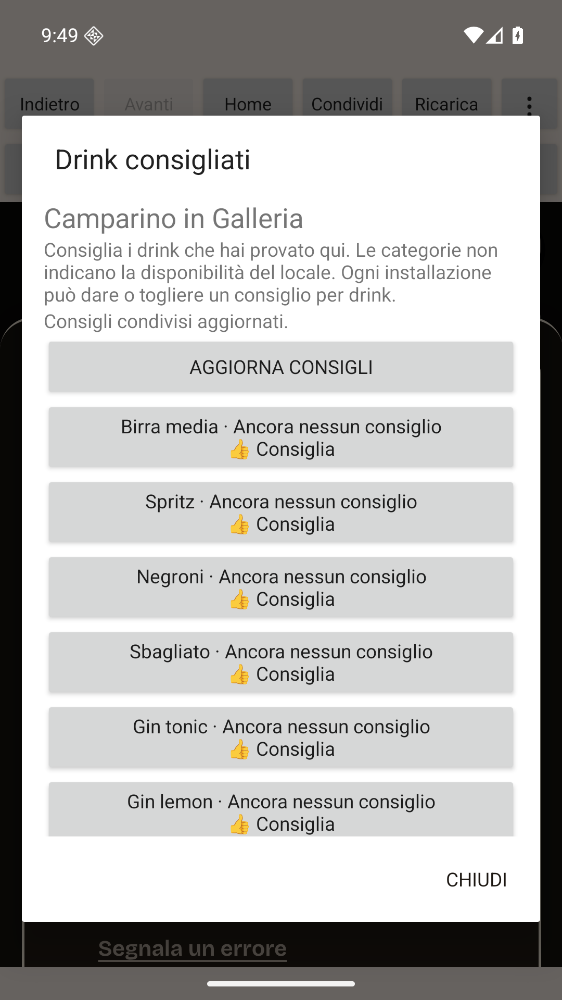
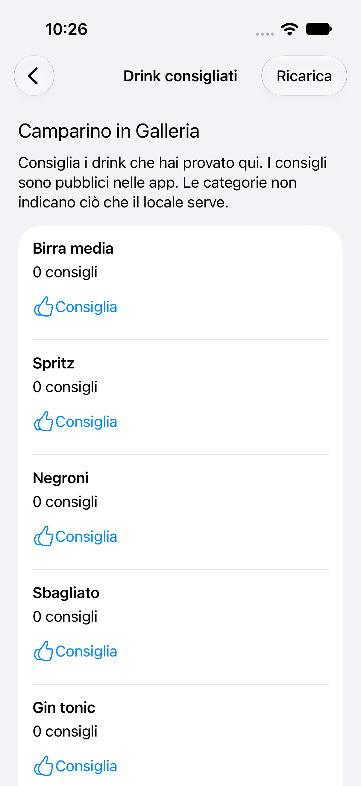

# Public drink recommendations in the phone apps

Verified on 28 October 2026: shared drink recommendations are available in **build 34** in Android internal testing and **Testing** in TestFlight for the existing owner and Roberto groups. The public Android 20/iOS 26 submissions are still under review. The owner confirms the build-34 venue name, nine categories, shared totals, scrolling and Back work on his personal iPhone. This is a narrow human-reported physical check; provider test availability is separate from a public launch.

On an open venue, the native **Drink consigliati** entry opens nine drink categories under the venue's existing name. Customers can add a thumbs-up, see shared totals and undo their own recommendation. Rows are ordered by total, then catalog order. A category is not evidence that the venue stocks it. Recommendations describe the venue and drink category, independent of changing prices or happy hour. Existing price submissions and accuracy confirmations retain their meanings.

The user's approved scope is apps only, with the website interface preserved. [PR 73](https://github.com/robertovalerirv-beep/dove-bevo/pull/73) adds the shared API and one table to the existing Worker/D1. Its five required CI jobs passed at `d803c1a0b32ba6ad2277ff166f437a764e9c6633`; matched-head merge produced `1a58d7332d4275e0a56ed21c60240459afab1a5e`. [Owner-main CI 40772515636](https://github.com/robertovalerirv-beep/dove-bevo/actions/runs/40772515636) and [automatic deployment 40774374138](https://github.com/robertovalerirv-beep/dove-bevo/actions/runs/40774374138) both succeeded at that exact merge. Migration, deployment and smoke steps passed. Independent and root anonymous public GET checks then returned 200/no-store for Camparino in Galleria, all nine valid categories, actual counts zero and own-state false. No public recommendations were submitted. Root's initial default urllib request received 403; a direct request with an identifying verification User-Agent passed, as did the actual normal Android client. This does not establish the reason for that first denial.

## Verification

- Root independently passed 669 server tests in 58 files, including 30 new real local Worker/D1 cases. Duplicate/undo/concurrent behavior, separate installations on shared Wi-Fi, quotas, visibility, strict input and existing price state are covered. TypeScript, focused ESLint and diff checks passed.
- Android central build passed 59 JVM cases, lint with zero errors and 24 warnings, and both debug APK compilations. The first actual emulator run passed 17 of 18 cases. Android SELinux denied the hard-link identity creation operation; that failure is retained. The create-only file repair was independently reviewed, rebuilt centrally, and all 18 runtime cases then passed in 82.019 seconds, including the identity, native toggle/undo, stale response and read-only fence controls. The repeated JVM/lint gate passed with 59 units, zero errors and 24 warnings.
- iOS source review identified dangling identity-link replacement and lossy numeric response validation. The narrow repair adds four native regressions. The first hosted beta candidate compiled and started all 57 unique unit cases: 54 passed, while three controller cases crashed after their first expected POST did not run. All four live phone UI cases passed, including native recommendation GET and return. The overall gate failed and both intended signers were skipped; a later partial 45-case suite is not a full pass. The test helper had dropped the cell owning its button action target. The narrow test-only correction retains actual table-managed cells, uses supported appearance transitions, guards request lookups and strengthens first-POST assertions. It received independent approval, then the corrected Mac gate passed all 57 unique units and four live UI cases, with no failures or skips. All three formerly crashing controller cases explicitly passed. Root independently passed all 102 local source guards in 39.106 seconds before that fixture correction; root's fresh corrected-source 102 guards also passed in 28.114 seconds.
- Normal Android production-shell QA resolved the existing Camparino name and opened the native screen. After the backend became available, the actual native refresh fetched authoritative shared counts; unavailable responses had shown no invented zero rows. Scrolling reached all nine drink rows at font scale 1.5; the original setting was restored and only the owned emulator was shut down. Subsequent anonymous GET still showed all counts zero. Original unedited screenshots are retained locally; this is Debug emulator evidence, with signed distribution and the separate iPhone report recorded below.
- The public and bundled privacy policy now describes anonymous public recommendations, installation identity and retention. The existing published Apple label includes linked Device ID and Other User Content for App Functionality. Google's existing in-review declaration also includes Device or other IDs and Other user-generated content, not processed ephemerally, for App functionality. Those answers were inspected without saving changes. No new analytics, advertising tracking, hardware identifier or account access is introduced.

No fabricated public votes, prices or venues are used for QA. Mutation cases use local/injected sinks. Live API and website verification is read-only. The private identifier limits repeated recommendations from an installation; it does not prove one human. Uninstalling or resetting the installation does not automatically withdraw existing public recommendations.

The Android 20 and iOS 26 public submissions remain separate from this update. The last observed Google state was **Changes in review**; Apple showed **Waiting for Review**. Historical build 32 testing availability is recorded in the [native update status](2026-10-28-native-update-status.md); build 34 now contains that automatic-name bookmark behavior and public recommendations. A signed upload, test-group availability, physical-device acceptance and public approval must each be verified separately.

Source, worktrees and local evidence remain in the selected OneDrive workspace; Roberto's GitHub repository is canonical. Local OneDrive presence does not establish provider synchronization. The coordinator owns integration, SDK execution and delivery. Three separate implementation lanes were reallocated to independent reviews; no writer's summary alone establishes completion.

## First signed-beta gate and corrected candidate

[Run 33](https://github.com/robertovalerirv-beep/dove-bevo/actions/runs/40775331769), tag `mobile-beta/v1.0.0-drink-recommendations.1`, exact source `1a765ebba6863212426817d629c090f17492c125`, failed its full iOS gate. Android's provider report independently and centrally verifies 59 tests, zero failures/skips, and lint with zero errors and 25 warnings. The extra hosted warning is the Gradle plugin update notice; central local lint has 24. The iOS failure excerpt, diagnostic-artifact pins and test accounting are retained. No recommendation release bundle or IPA was signed from that run.

The corrected candidate changes the iOS unit fixture only. Production iOS/Android code, the shared API and all four live UI cases retain the same bytes; the full fresh beta gate passed before either signer started. No existing tag is moved and no failing result is replaced with a partial pass.

## Verified build 34 delivery

[Run 34](https://github.com/robertovalerirv-beep/dove-bevo/actions/runs/40778935536), tag `mobile-beta/v1.0.0-drink-recommendations.2`, exact source `388e200844ced599be4212e6d6af5c23744fe3f1`, succeeded. Android: 59 units, zero failures/skips, zero lint errors and 25 hosted warnings. iOS: 102 script guards, **57 native units and 4 live phone UI cases passed**, no failures/skips. Both intended signing jobs then succeeded. The policy and Android inputs are byte-identical to the centrally tested revision.

| Artifact | SHA-256 | Verification and availability |
| --- | --- | --- |
| Android build 34 AAB | `29c687d027b3617b96467259718ceb7681866450fd69d02f0cdce02f7cb4b34b` | Non-debuggable `com.dovebevo.app`, version 1.0.0/34, minimum API 24/target 36, approved upload certificate; Google internal release 4 **Active / Available to internal testers**, released 28 October at 22:36 UTC |
| iOS build 34 IPA | `a1d6ed1344a0127ed3887108de1a515e03ad5728ecb30bea6da9546d1ee5583f` | Eligible `app-store` distribution, matching app/team/build, approved unchanged profile/certificate, strict Mac signing and successful upload; App Store Connect processed it and shows **Testing** for both existing groups |

Both binaries contain the exact public privacy policy SHA-256 `4f47b92cd3a325bb1a055eed4487b899c90b9471230affbb92f2c40baaf1d82f`. Provider ZIP digests, archive-safety checks, package/profile metadata, signer manifest and original provider screenshots are retained in the selected project evidence folder. Local Windows parsing and non-strict Java verification do not replace the strict Mac/CI signature gates. The signer manifest deliberately reports App Store processing as unverified; subsequent browser readback separately establishes processing and Testing.

The existing owner group is Internal with one tester; Roberto feedback is External with one tester. Automatic notification was selected. Provider group assignment does not prove email delivery or acceptance. The owner separately reports the specified build-34 iPhone browsing checks passed; Roberto's installation remains unverified. The Android tester configuration was preserved. Google reported no unsupported-device loss; its only upload warning concerns an absent deobfuscation file for this non-obfuscated bundle.

Current public review readback remains **Google Changes in review** (managed publishing off) and **Apple Waiting for Review**, build 26 with automatic release after approval. No old public submission was withdrawn or replaced. Real-iPhone acceptance was requested only after build 34 became available; Phone Link cannot operate iPhone apps. The owner subsequently confirmed the requested name, nine categories, shared totals, scrolling and Back checks work on his personal iPhone. Public vote/undo, location, offline behavior, sharing and Android physical installation were not part of that phone confirmation.

## Original native QA views

These are unedited Debug emulator/simulator captures of real read-only service data, not store screenshots or signed physical installations. [Provenance and hashes](images/public-drink-recommendations-provenance.json).

| Android | iOS |
| --- | --- |
|  |  |
